<div align="center">

**🤖 Made with [Claude Code](https://claude.com/claude-code), Anthropic's coding agent**

# Modula

### The Playnite theme that is stunning out of the box, and yours to bend into any shape.

Liquid-glass desktop theme + a PS5-style Fullscreen theme, one look, one set of rules.<br>
**705 settings** (646 on the desktop, 59 in Fullscreen), **30 ready-made global looks**, 25 colour profiles, 12 fonts: built end to end with [Claude Code](https://claude.com/claude-code).<br>
Rearrange, resize and recolour everything live with the **[Layout Studio](https://github.com/YannD-Delta/Layout-Studio)** editor.

[](https://playnite.link)
[](LICENSE)
[](https://claude.com/claude-code)


</div>

---

## Why Modula

Most Playnite themes make you choose: pretty or configurable. Modula is built to be both.

- **Sublime by default.** Install it, pick a game: frosted liquid glass, soft glows, the game's own art washing over the page. No setup.
- **Ultra customisable: 705 settings.** Every section, size, corner, colour, font, background and information card is a setting (646 on the desktop, 59 in Fullscreen, 245 choices in 44 preset groups). With Layout Studio you drag sections between columns, generate a background (flat, gradient, soft circles, patterns) and watch the real window change while you edit.
- **One look on desktop and on the TV.** Modula Desktop and Modula Fullscreen share the same rules: the same accent colours, rounded corners, glow, and the same information cards.
- **Never an inner scrollbar.** Sections adapt to their content instead of hiding it behind nested scroll areas.
- **Your add-ons, integrated.** It uses the Playnite add-ons you already have (achievements, HowLongToBeat, activity, music...) and hides what is not installed.

## Desktop

<table>
<tr>
<td width="50%">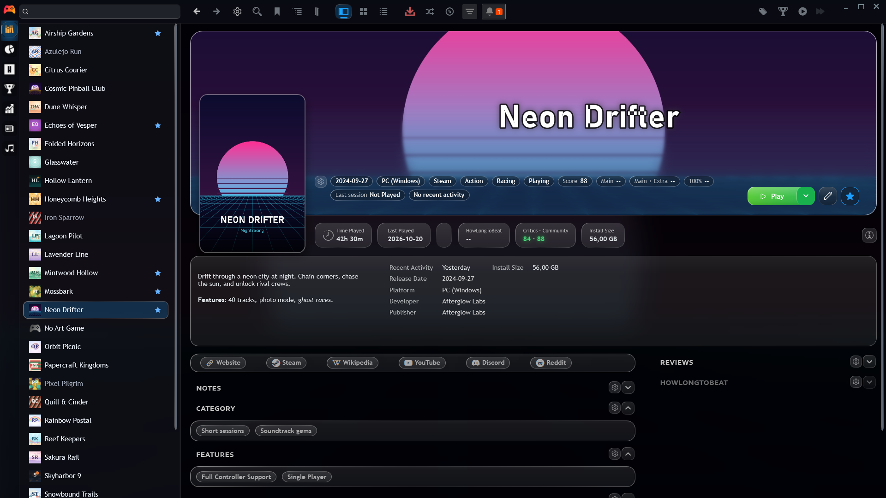</td>
<td width="50%">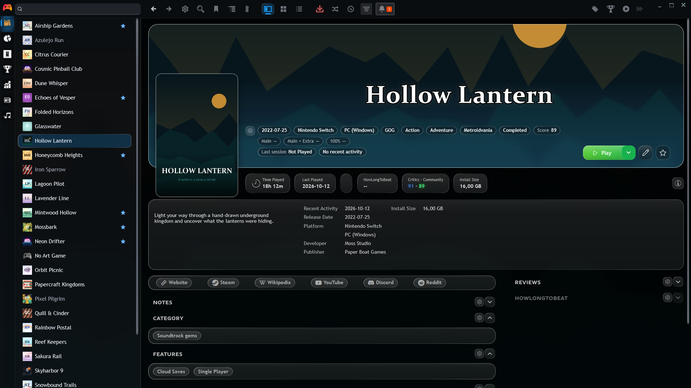</td>
</tr>
<tr>
<td align="center"><sub>The page takes its colours from the game's art</sub></td>
<td align="center"><sub>Glass tiles, chips and link buttons share one recipe</sub></td>
</tr>
</table>

- **Liquid Glass material**: translucent panels with a soft rim, gloss and bloom. Tiles, chips, link buttons and the Play button are the same family, so nothing looks bolted on.
- **Header cards**: choose which facts show above the description (time played, last played, scores, install size, HowLongToBeat, activity...). Scores are colour-coded by value.
- **Sections you control**: reorder, hide, collapse or move them to the other column. Every section can switch column, add-on sections included.
- **Thirty looks, one click**: global presets such as Paper Gallery, Graphite Desk, Neon Arcade or Aurora Glass change the whole design at once, and the pieces are still yours to mix: material (Liquid Glass, Frosted Mono, Neon Night, Flat, Lite), spacing (Compact, Comfortable, Airy), corner rounding (Square to Very round), a **Light** profile family and a generated window backdrop.
- **25 colour profiles (7 of them light) and 9 accents**, 12 font personalities, or any `#RRGGBB` of your own.

<table>
<tr>
<td width="25%">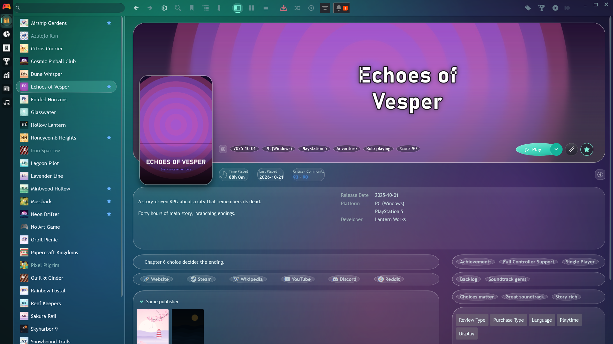</td>
<td width="25%"></td>
<td width="25%">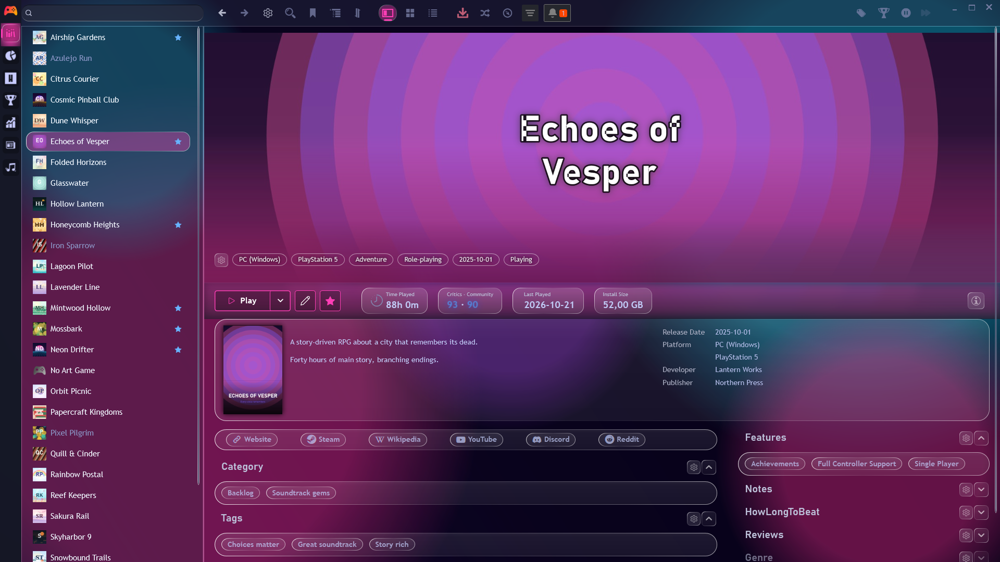</td>
<td width="25%">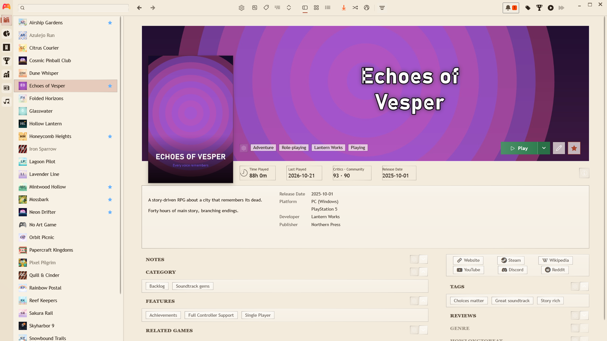</td>
</tr>
<tr>
<td align="center"><sub>Aurora Glass</sub></td>
<td align="center"><sub>Graphite Desk</sub></td>
<td align="center"><sub>Neon Arcade</sub></td>
<td align="center"><sub>Paper Gallery</sub></td>
</tr>
</table>

Every view is themed: list, grid, grid + details, the explorer panel and the filters, on a light game as on a dark one.

<table>
<tr>
<td width="33%">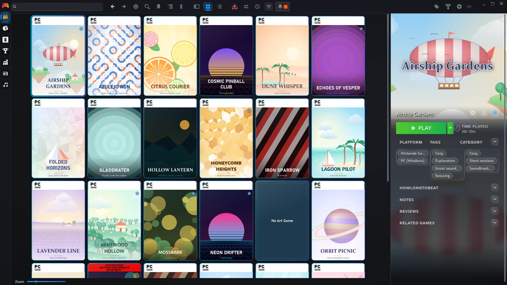</td>
<td width="33%">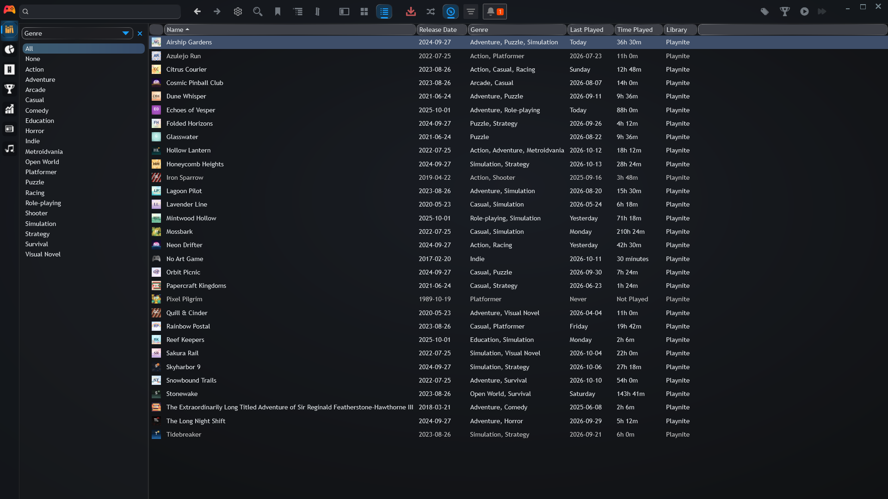</td>
<td width="33%">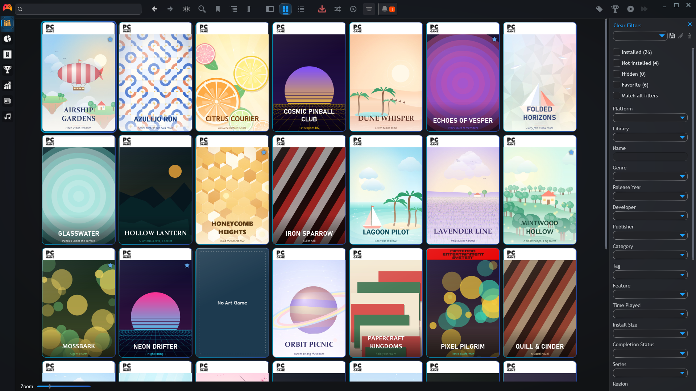</td>
</tr>
<tr>
<td align="center"><sub>Grid + details</sub></td>
<td align="center"><sub>List with the explorer</sub></td>
<td align="center"><sub>Grid with the filters</sub></td>
</tr>
</table>

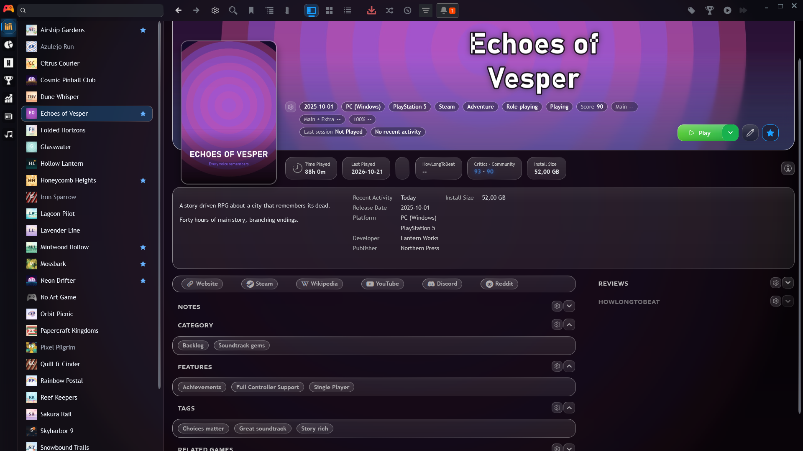

## Fullscreen

A home that feels like a console: big cards, a hero title, the game's art behind everything, a focus ring that glows, entrance animations, and interface sounds. Built for a controller and a TV.

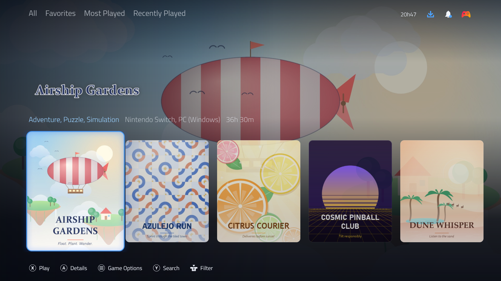

<table>
<tr>
<td width="50%">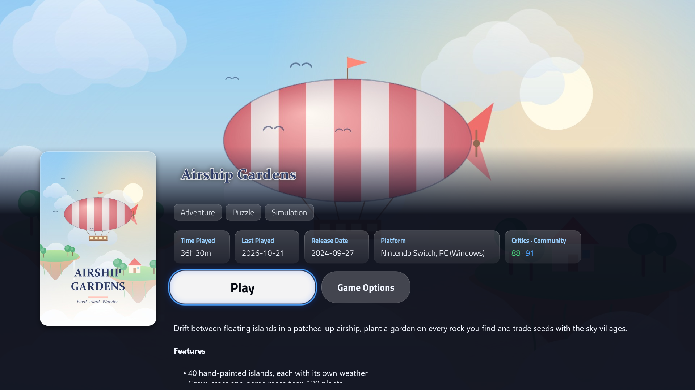</td>
<td width="50%">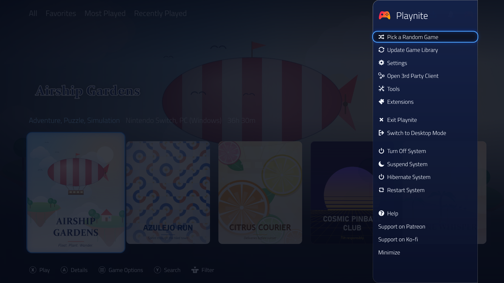</td>
</tr>
<tr>
<td align="center"><sub>Details: glass info cards, a white Play pill, the cover</sub></td>
<td align="center"><sub>Main menu, restyled to match</sub></td>
</tr>
</table>

Accent colour, corner roundness, glow and which information cards to show are presets you can change from the Fullscreen main menu (Extensions > Layout Studio), with the controller, without leaving the couch:

<table>
<tr>
<td width="25%">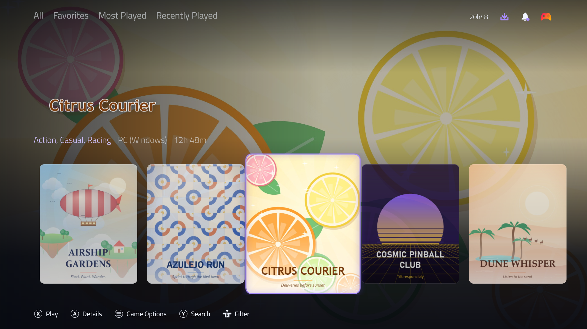</td>
<td width="25%"></td>
<td width="25%">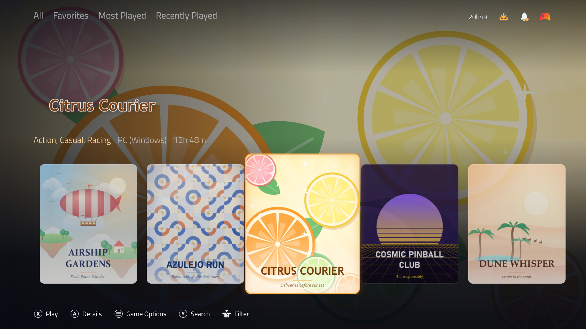</td>
<td width="25%">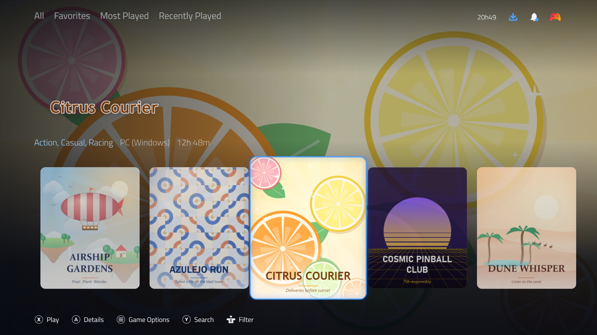</td>
</tr>
<tr>
<td align="center"><sub>Violet</sub></td>
<td align="center"><sub>Mint</sub></td>
<td align="center"><sub>Amber</sub></td>
<td align="center"><sub>Very round corners</sub></td>
</tr>
</table>

## Layout Studio, the editor behind it

Modula ships its settings through **[Layout Studio](https://github.com/YannD-Delta/Layout-Studio)**, a Playnite extension that replaces the usual options page with a live editor: a search box over every setting, drag-and-drop sections, visual size handles, **presets shown as picture tiles** so you see what a choice changes, segmented switches, number boxes with no hard limit (the slider is a guide, type any value), undo and redo, and profiles you can export as a short text code and share. The first page, **Graphics and performance**, detects Playnite settings that break the look or cost performance, says which of the two each one touches with measured numbers, and fixes them in one click. The small gear next to each section in the theme opens the editor on the right page.

<table>
<tr>
<td width="33%">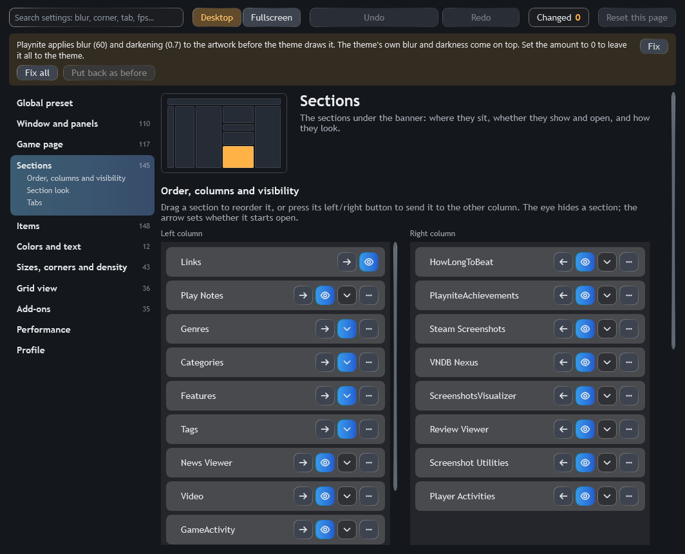</td>
<td width="33%">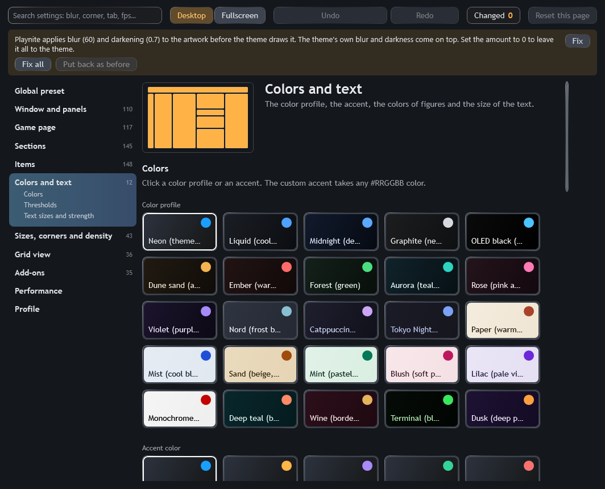</td>
<td width="33%">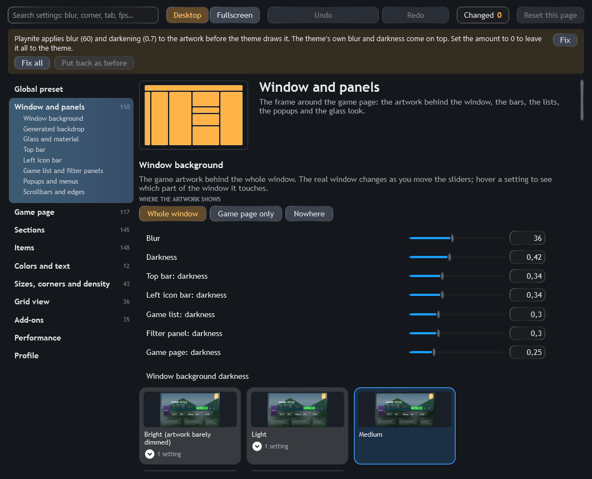</td>
</tr>
<tr>
<td align="center"><sub>Drag sections between columns</sub></td>
<td align="center"><sub>Colour profiles and accents</sub></td>
<td align="center"><sub>Looks, spacing, corners</sub></td>
</tr>
</table>

### Global presets: 30 looks in one click

The first page of the editor, **Global preset**, shows a card per ready-made look, each with a picture of the real window. A global preset sets the *whole* look at once (every preset group and every value: colours, material, fonts, density, corners, accent, the generated window backdrop, the hero, the placement of the sections, the information shown); click a card, then click it again to apply it. Your previous profile is saved first. A new profile starts from the default preset, and "Reset all" returns to it.

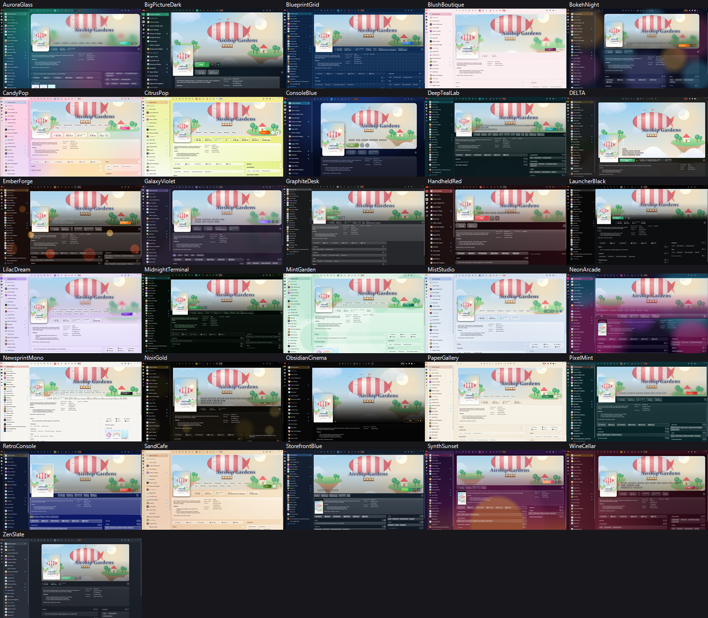

| Preset | Art direction |
| --- | --- |
| Paper Gallery | A warm cream editorial gallery: Georgia type, square thin-ruled frames, a big cover, captions instead of cards, two calm columns. |
| Mist Studio | Cool grey-blue frosted glass floating over a soft gradient: big round corners, four large cards, a wide main column and a slim side column. |
| Sand Café | A friendly sand-and-terracotta café: airy spacing, pill chips and buttons, warm blobs of colour behind soft rounded cards. |
| Mint Garden | Fresh mint and deep green: friendly type, crisp circles over a pale green field, rounded cards and almost all the sections in the right column. |
| Blush Boutique | A powdery pink boutique: thin plum outlines on a dotted blush field, a very big cover and only the essentials of information. |
| Lilac Dream | A pastel lavender dream: a radial glow in the window, a soft glowing full-width tinted hero, round cards and two quiet columns without titles. |
| Newsprint Mono | Black ink on newsprint: a monospace terminal-on-paper page with square hairline boxes on ruled paper, twelve header cards and every information row. |
| Citrus Pop | High-energy citrus: black ink on white cards over a yellow-lime gradient, one orange accent, chunky pill buttons and eight big header cards. |
| Obsidian Cinema | True black screening room: a full-width hero with the cover inside, heavy cinematic shade, no chips, no section titles, amber for the one light that matters. |
| Midnight Terminal | A console in the dark: monospace everywhere, hairline phosphor outlines, square cells on a character grid and every field of the game printed at once. |
| Wine Cellar | A candle-lit cellar: deep bordeaux gradient, serif type, warm gold edges and two balanced columns of softly rounded cards. |
| Deep Teal Lab | A clinical lab dashboard: flat deep-teal instrument cards, twelve data tiles, small corners, cyan readouts and the sections stacked in a right-hand rail. |
| Graphite Desk | A neutral workstation: flat opaque graphite, square corners, compact Tahoma text, a text-only status line and every information row on one dense column. |
| Ember Forge | A working forge: hot orange on charcoal, hard 3 px edges, a cover framed in amber, outline chips and sparks of ember floating in the dark. |
| Noir Gold | Old-world luxury: gold hairlines on black, a large book-set cover, almost no chrome, and bokeh of gold dust behind a calm single flow. |
| Blueprint Grid | An architect's drawing board: cyanotype blue with a white-cyan drafting grid, square cells, drawing-style type and every annotation of the game laid out in two ruled columns. |
| Neon Arcade | Arcade cabinet at night: black-violet cabinet, hot pink and electric cyan tubes, a full-width marquee banner and score-board cards. |
| Candy Pop | A sweet-shop window: pastel pink and lilac, turquoise and lemon candy circles, chunky pill shapes and sticker-like chips and cards. |
| Aurora Glass | Liquid glass over a northern-lights sky: nothing but thin bright rims and blur, a hero that melts into the aurora, section titles left out. |
| Synth Sunset | Retro-futurist 1985 horizon: a magenta-to-orange sunset with a grid, thick glowing rims, a wide letterbox banner and two even columns. |
| Bokeh Night | A cinematic night street out of focus: deep navy, warm amber and pink city lights, soft glass, a framed hero and a quiet narrow reading column. |
| Retro Console | 16-bit console menu: royal-blue screen with a halftone dot grid, thick white window frames, square corners, mono type, primary red and yellow, a big boxed cover. |
| Pixel Mint | Handheld-colour mood made modern: mint ink and hot coral on dark teal, a pixel grid, flat panels with 2 px outlines and small hard corners. |
| Storefront Blue | A store-page look: deep desaturated blue, a big banner hero with a large green Play button, a tight list and compact stacked panels in a main column with a slim sidebar. |
| Launcher Black | A flat black-and-grey launcher: hairline separators, square corners, plain-text chips and tiles, dense type and one white accent, with the content weighted to the left. |
| Galaxy Violet | A violet social launcher: blurred artwork behind everything, pill buttons and chips, big round corners, tabs over the sections and a friends-style info panel (library, added, recent activity). |
| Console Blue | A living-room console screen: a blue radial glow, a big cover card, large airy type, very few chips and cards, no section headers and a bare top panel. |
| Handheld Red | A handheld-first look: bold crimson on dark, big touch-sized buttons and list rows, high-contrast text, a tight full-bleed hero and only the essential sections. |
| Big Picture Dark | A couch-friendly desktop: an oversized edge-to-edge hero, big type, almost no clutter (no chips, no section headers, few rows), a near-black backdrop with faint blobs and strong focus rings. |
| Zen Slate | A calm professional slate: airy spacing, soft borderless glass, a centred hero over a single centred column of sections, a quiet dotted backdrop and a discreet accent. |

These are starting points to bend, not locked themes: change anything afterwards and the card says "in use, edited".

Modula also runs without Layout Studio with its default look (the `options.yaml` presets are readable by the Theme Options extension), but you then lose the live editor, the Fullscreen quick menu and the colour rules of the information cards.

## Install

1. Install [Playnite](https://playnite.link) 10.x.
2. Download the latest `.pthm` files from the [Releases](https://github.com/YannD-Delta/Modula/releases) page and double-click them: **Modula** (desktop) and **Modula Fullscreen**. Or copy the `Modula` and `Modula-Fullscreen` folders into `<Playnite>\Themes\Desktop` and `<Playnite>\Themes\Fullscreen`.
3. Install **Layout Studio** (`.pext` from its [releases](https://github.com/YannD-Delta/Layout-Studio/releases)).
4. Select the theme in *Settings > Appearance* and restart Playnite. Open the editor from *Main menu > Extensions > Layout Studio*.

If you use **Theme Options** or a similar extension for another theme, disable it while Modula is active: Layout Studio stays idle while ThemeOptions is enabled so a setting is never applied twice.

## Supported add-ons

Nothing is required: the theme works without any add-on, and each integration hides itself when its add-on is missing. At start, Layout Studio shows one Playnite notification naming the recommended add-ons you do not have yet (and only again if that list changes).

| What Modula shows | Add-on |
| --- | --- |
| The editor, presets, colour rules, Fullscreen quick menu | [Layout Studio](https://github.com/YannD-Delta/Layout-Studio) |
| Game logo (banner), trailer video (section; the add-on's own alternative player can sit in the banner) | [Extra Metadata Loader](https://github.com/darklinkpower/PlayniteExtensionsCollection) |
| Rotating, animated and video covers and backgrounds (banner background, banner cover, Grid view) | [ImageRotater](https://github.com/Mike-Aniki/ImageRotater) |
| A chip in the top bar while a game runs (its icon, name, session time; a click returns to it), or a plain Back to game button | [Now Playing](https://github.com/jonosellier/NowPlaying), or [Back To Game](https://codeberg.org/ashpynov/BackToGame) |
| Library overview (top bar button): library numbers, play time, game of the month, a suggested game, most played, completion, sources, latest Steam updates | [AnikiHelper](https://github.com/Mike-Aniki/AnikiHelper) (public data only; nothing of its Fullscreen theme is used) |
| What your friends played, achieved and finished for this game (section) | [PlayerActivities](https://github.com/Lacro59/playnite-playeractivities-plugin) |
| The add-on's own notifications (volume and device changes, controller connections) in the theme's colours | [Audio Switcher](https://github.com/Naerian/playnite-nx-audio-switcher), [Controller Manager](https://github.com/Naerian/playnite-nx-session-controller-manager) (they add their own button to the top bar; Modula only ships the colour mapping their "follow the active theme" switch reads) |
| Achievements: progress bar, latest unlocked, unlocked and locked lists, full list (section and header card) | [Playnite Achievements](https://github.com/justin-delano/PlayniteAchievements) |
| Time to beat (header card, progress bar, section) | [HowLongToBeat](https://github.com/Lacro59/playnite-howlongtobeat-plugin) |
| Play time charts and session log, hardware stats (FPS, CPU, GPU, RAM) | [GameActivity](https://github.com/Lacro59/playnite-gameactivity-plugin) |
| Same developer, same publisher, same series, similar games (sections) | [Game Relations](https://github.com/darklinkpower/PlayniteExtensionsCollection) |
| DLC lists and button (section) | [CheckDlc](https://github.com/Lacro59/playnite-checkdlc-plugin) |
| Steam news (section) and players online now | Steam News and Players Viewer (News Viewer) |
| Steam reviews (section) | Steam Reviews Viewer (Review Viewer) |
| Your own screenshots (section and button) | [ScreenshotsVisualizer](https://github.com/Lacro59/playnite-screenshotsvisualizer-plugin) |
| Store screenshots (section and button) | Screenshot Utilities, with a provider such as its Steam provider |
| Steam screenshots (section) | the Steam Screenshots add-on |
| Personal notes (section) | Play Notes |
| Visual novel information (section) | VNDB Nexus |
| A web page in the game page (section) | Web Explorer |
| Play state switch | PlayState |
| Prefix icons on genres, categories, features and tags | Metadata Utilities |
| Background and cover changer controls | Background Changer |
| User rating, completion status, back and forward buttons | [ThemeExtras](https://github.com/felixkmh/ThemeExtras-for-Playnite) (felixkmh's Extras plugin) |
| Library management icons, game update status, Steam shortcuts, system requirement and localization checks | Library Management, Game Update Status, Steam Shortcuts, System Checker, Check Localizations |
| GOG second-class watcher, duplicate source selector | GogSecondClassWatcher, Duplicate Hider |
| Per-game music while you browse; an optional player in the banner; a quick toggle in Fullscreen | [UniPlaySong](https://github.com/aHuddini/UniPlaySong) |
| Smooth background transitions when the game changes | [Custom Fade Animations](https://github.com/saVantCZ/CustomFadeAnim) |
| Resolution, refresh rate and HDR when a game starts (handy on a TV) | [Display Manager](https://github.com/Naerian/playnite-nx-display-session) |
| Playtime trends and rankings | [Playtime Insights](https://github.com/SHINKU1506/PlaytimeInsights) |

That makes 34 add-ons hosted or read by the theme, plus Layout Studio, and 2 more whose notifications follow its colours. Each one hides itself, and takes no room, when it is missing; none is required. Checked on a test bench with the add-on installed: see the CHANGELOG for what was seen working and what was only read from the add-on's documentation.

Every section of the game page above can be moved to the other column from Layout Studio (the extension moves the live block, so the add-on keeps working). The control names come from the theme's source; check each add-on's exact name in Playnite's add-on browser.

## Recommended settings, and why

These come from a real setup (4K screen, Playnite 10.62, a library of about 1,800 games), with measurements where there is a number. Anything marked *(unverified)* comes from reading an add-on's code or documentation, not from a test here.

### Images (Metadata Image Optimizer)

- Backgrounds: JPEG, quality 90, at most 3840x2160. Covers: JPEG, quality 90, at most 600x900. Icons: PNG, 128x128 (they need transparency).
- **Why:** decoding time decides how smooth the game list feels, and the decoded bitmap takes the same memory whatever the file format, so the pixel size is what counts. Measured WPF decode with the cache off: a 4K background took 205 ms as WebP, 41 ms as JPEG and 75 ms as PNG (PNG also weighs about 8 MB each); a 400 px cover took 7.8 ms as WebP and 5.6 ms as JPEG. WebP is smaller on disk but the slowest to read.
- Quality 90 instead of 100: much smaller files, no visible difference.
- The optimizer never enlarges an image: a cover already shrunk to 400 px stays blurry on 4K. Download covers again at a larger size, then let the optimizer convert them.
- When you change formats, run the optimizer on all games, hidden ones included (Ctrl+A does not select hidden games).

### Metadata sources (Universal Steam Metadata)

- Turn on **DownloadVerticalCovers**: Steam games then get the vertical 600x900 cover instead of the horizontal header image, which is what a portrait cover slot needs.
- Background source: *Banner* is meant for a banner (the wide Steam hero image, the sharpest when it exists); *StoreScreenshot* is 1920x1080 and may show the game's interface; *StoreBackground* is the smallest (about 1438 px wide). *(unverified: sizes follow Steam's usual asset sizes, not the add-on's documentation.)*
- A new setting only applies to the next downloads: to replace existing images, run "Download metadata" with overwrite for covers or backgrounds, on a few games first.

### Playnite settings

- **Show background image on window: ON.** The glass effect of the theme uses that image. Modula warns you when it is off.
- **Playnite's own blur and darken: 0.** Modula already blurs and darkens; stacking both darkens the image twice and costs GPU. Layout Studio's Background page shows the real window as you move the sliders.
- **Background image animation: OFF.** Measured on a test bench: about +18 % CPU, +60 % GPU and +43 MB of memory.
- **Asynchronous image loading: ON.**

### Performance with a large library

- The achievements section is the main idle cost on a big library (measured). If Playnite uses a full core while idle, hide the three achievements displays (list, latest, data grid) in Layout Studio.
- Playnite's image cache and the embedded browser's code cache can grow to several GB and are rebuilt on demand: clear them from time to time. Keep the browser's cookies folder: it holds your store logins.
- Disable library add-ons you do not use. Login errors at start for stores you are not signed in to (Battle.net, EA app) are known Playnite behaviour and harmless.
- The window glass blur is computed once and cached (about 2 % GPU instead of 13 % while the game list scrolls on the test machine); the glass has a Lite material preset and a "Graphics and performance" page for weaker machines.

### Music (UniPlaySong)

- Use **UniPlaySong** for game music: it is the one player the theme integrates. Do not run a second music player next to it (Playnite Sounds Mod, for example, has its own music engine and the two would fight).
- UniPlaySong already adds play, pause and next to Playnite's top bar. The theme's own ready-made player in the game banner (option "Show the music player") is **off by default**; turn it on if you want cover, title and previous/next on the game page.
- UniPlaySong stores one audio file per game and downloads them from YouTube with yt-dlp and FFmpeg (Deno may be needed). With hundreds or thousands of games, turn automatic download on library update and on install OFF and download music only for the games you care about: music then exists only for chosen games.
- Cookie source: if downloads fail with "could not read browser cookies", close the browser or change the cookie source (hundreds of failures were seen while the browser held its cookie file locked).
- Keep yt-dlp and FFmpeg up to date: YouTube changes often.

### Screenshots

- **ScreenshotsVisualizer** shows YOUR captures (it scans the folders you give it: Steam, Xbox Game Bar, capture software). **Screenshot Utilities** shows store screenshots from its providers and does not handle your own captures: they do different jobs. If a provider logs many errors (dead store image links), disable that provider.

### Hardware stats (GameActivity with HWiNFO)

- Use the HWiNFO Gadget provider: in HWiNFO publish the sensors to the Gadget, then in GameActivity assign each sensor by its index (FPS, CPU usage, CPU temperature and power, GPU usage, temperature and power, RAM). HWiNFO must be running during the game, otherwise the session records zeros.
- Warnings about FPS "1 % low" and "0.1 % low" are normal with HWiNFO only: it does not publish them.

### Add-ons you can skip

- Mo Data (battery, Wi-Fi and disk widget for Fullscreen themes): Modula does not use it.
- Screenshot Utilities, if you only care about your own captures.

## Made with Claude Code

Modula and Layout Studio were designed and built together with [**Claude Code**](https://claude.com/claude-code), Anthropic's coding agent: the XAML, the C# extension, the tests, the generators, the screenshots and these docs. The direction, the taste and every decision come from the human behind it; the typing came from the agent. Everything is verified the boring way: a lint for the themes, an automated test suite for the extension, and a sandbox Playnite with fake games for the screenshots you see here (no real library, no personal data).

## Credits and licence

Modula started from three excellent MIT-licensed Playnite themes and keeps their notices:
**Neon** (Xenor), **Helium** (darklinkpower) and **Dune Rev** (hugsyf). See [THIRD-PARTY-NOTICES.md](THIRD-PARTY-NOTICES.md).

Modula is released under the [MIT licence](LICENSE). What is inside the themes:

- **Code and styles**: XAML written for Modula, or inherited from the three MIT themes above and from Playnite's own default themes (Playnite is MIT too).
- **Sounds and music** of Modula Fullscreen: synthesised by `make-audio.py` in the author's tooling, no samples, no third-party audio.
- **Fonts**: none are shipped. The themes use Segoe UI Variable and Segoe Fluent Icons from Windows, and the Titillium font that Playnite itself provides.
- **Platform, store and social logos** in `Images/Banners` and `Images/*.png` (Steam, Discord, Reddit...) come from the upstream themes. They are trademarks of their owners and are only used to label the matching platform or link.
- **Screenshots** use generated placeholder art and fictional games.

Modula is an independent theme and is not affiliated with Playnite or any platform shown.

## Playnite's add-on browser

Playnite lists themes in its built-in add-on browser through [a community database](https://github.com/JosefNemec/PlayniteAddonDatabase). Theme submissions are open; submissions of extensions are currently on hold (the maintainer plans a new database with a verification system for Playnite 11). Until Modula is listed, install it from the [Releases](https://github.com/YannD-Delta/Modula/releases) page as described above.

## Feedback

I would love to hear what you think, what breaks, and what you would change.

- Open an [issue](https://github.com/YannD-Delta/Modula/issues) on GitHub for bugs and ideas.
- Talk to me on Discord: **yannd_delta** (or open an issue, either is welcome).
## Contributing

Issues and pull requests are welcome. Before sending a change to a theme, run the lint:

```bash
python tools/check-theme.py Modula
python tools/check-theme.py Modula-Fullscreen
```
